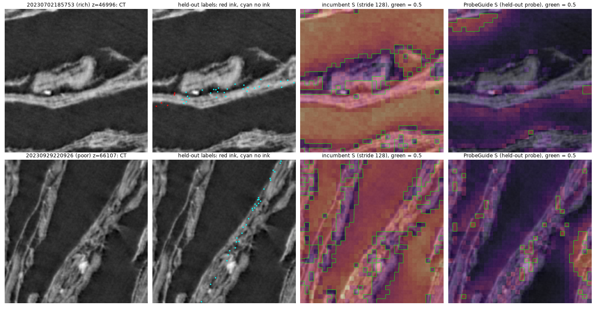

# ProbeGuide: an audit of the DINO gate in villa's 3D ink pseudo-label recipe (plus a linear-probe alternative)

## Author's note

I understood that currently the team is making ink labels by using two things together. To start, there is an ink model that is taking a guess and that is multiplied by the result of a model (called DINO) that establishes "how similar each spot looks to a reference example"

I wanted to see if the DINO part actually helped or not by testing it and my own version of that step against the ink model on its own.

The result surprised me, because the DINO model (or my own model) mostly doesn't help. 
The reason is because when the ink model is decent, the DINO step throws away real ink.
If the goal is fewer false ink labels, we can achieve the same results by simply raising the ink model's own cut off.

I believe the test can be trusted as I used several of the public ink models that had never seen this scroll (for this test) and the test plan was written before running them.
There is one limit as this test was done only on one scroll.

I did use AI to help me get to this conclusion, but I ran the tests and reviewed the results myself. 
The model used was Claude Opus 5.5

---

**TL;DR.** villa's staged DINO-guided 3D ink recipe (restored in PR #1523 so it "can be rerun from main") makes
pseudo-labels as `(frozen ink-teacher probability × S) > 0.5`. S is the cosine of each Dinovol token to **one averaged
reference embedding, min-max normalised per 256³ chunk**. We audited this gate on 8 held-out PHerc. Paris 4 segments
(the team's `20260918` ink labels) at the team's own setting (`dino_stride: 128`). Most results were pre-registered.

1. **The gate buys precision less efficiently than raising the teacher's own threshold.**
   - Pre-registered H4, on 2 cross-scroll teachers that never saw Paris 4 (§3c, §3e).
   - At the shipped 0.5 rule, the gate's label lies below the teacher's own precision-recall curve: +0.16–0.18
     precision at equal recall, 7/8 segments. This is a diagnostic that uses the test labels to trace the curve.
   - The gate keeps 41% of the teacher's true ink pixels and 18% of its false ones.
   - A label-free matched threshold gives similar F1 on average (not significant, with unstable per-segment recall),
     without the Dinovol pass.
2. **With a decent teacher, the gate removes real ink.** The iteration-0 teacher (AUROC 0.86) was pre-registered as a
   per-segment test: −0.107 AUPRC, 1/8 positive, Wilcoxon p = 0.016. A within-chunk check added afterwards by the
   reviewer gives −0.094, 0/8, p = 0.008.
   - On the pre-registered *weak* teacher (AUROC 0.80) the drop is −0.042, 6/8, p = 0.055: not significant after
     correction. **So the harm is teacher-dependent.**
   - Two stronger ladder teachers point the same way (descriptive only), as does the public in-scroll U-Net (§3b).
3. **No DINO variant we tested adds to a decent or weak teacher within chunk.** That includes a linear probe gate and
   a fitted log-odds fusion, and it holds across 30 brainstormed ideas (§3e).
   - Only teachers near chance (AUROC 0.52–0.59) gained from DINO. That is descriptive, not a claim, and expected,
     because the probe alone (AUROC 0.64) beats them.
4. **As a similarity map, a linear probe beats the prototype, but less than the pooled numbers suggest (§3a).**
   - Pooled over our ink-rich/ink-poor chunk sample, AUROC 0.52 → 0.67 (AUPRC t p = 0.011, 7/8).
   - Within chunks, which removes between-chunk ranking, AUROC 0.59 → 0.67:
     - sparse labels +0.080 (t p = 0.076, Wilcoxon p = 0.055, 7/8);
     - dense labels +0.083 (t p = 0.030, Wilcoxon p = 0.039, 6/8).
   - Within-chunk AUPRC: +0.055 sparse (t p = 0.10, 5/8), +0.050 dense (Wilcoxon p = 0.039, 6/8).

**Advice to the team when the staged recipe is rerun (e.g. on a new scroll):**
- measure the DINO gate against the ungated teacher on held-out labels before using it;
- if a more precise label is wanted, consider raising the teacher's own threshold instead (similar F1 on average; the
  villa configuration for "teacher alone at a raised threshold" is untested);
- DINO information only helped teachers near chance in our tests.

ProbeGuide ships the audit scripts (every number here is emitted by a committed script), the probe weights, and a Python
subclass `ProbeGuidedLabelGenerator` with a small villa patch for anyone who wants to test a probe gate.

**Where this matters.** The DINO gate is the *bootstrap* stage of the recipe (teacher → v1 → v2 → v3
self-distillation). The released `ink_3d_dino_guided` model (v3) no longer uses it, and PR #1523 restored the stages so
they can be rerun.

---

## 0. Why the team cares (live Open Problems page, verbatim)

From https://scrollprize.org/2026_open_problems#self-supervised-3d-representations:

> "If ink-like voxels form a recognizable cluster in embedding space, a small number of expert-selected examples may
> help generate many candidate labels. This is especially attractive for our data because the volumes are enormous
> and labels are scarce."

> "Labels derived from DINO embeddings in the scroll domain are usually either coarse or noisy."

From https://scrollprize.org/2026_open_problems#direct-3d-ink-segmentation:

> "The 3D UNet segmentation model for ink segmentation was not only DINO guided, but it also used self-distillation"

This package measures how much the DINO-derived gate helps or hurts the labels, at the team's settings.

## 1. What the incumbent does (as configured in `ink_detection/configs/dino_guided_v1.json` / `_v2.json`)

`vesuvius/ink_detection/training/dynamic_labels.py::DinoGuidedLabelGenerator`:

```
label = (frozen ink-UNet probability  x  S) > 0.5          (v2 additionally gates raw CT > 50)
S     = minmax_chunk( cos(token, avg_ref_embedding) )       # 256^3 chunk, 128^3 windows, dino_stride 128
```

- At stride 128 the 8 windows do not overlap, so the Gaussian blend is a no-op.
- `avg_ref_embedding.npy` (HF `scrollprize/ink_3d_dino_guided`) is the mean of the expert-clicked tokens in
  `recorded_embeddings*.npy`. The card says 256 clicks, but **the two files are byte-identical, so there are 128
  unique clicks** (same sha256; their mean reproduces `avg_ref_embedding` with cosine 1.0000).

ProbeGuide keeps the backbone, windows, stride, upsampling, U-Net and label rule, and replaces the per-token score with
`sigmoid(normalize(token) · w + b)`, with no per-chunk min-max. A unit test proves the geometry equals the parent's
exactly (strides 64/128, batch 2, a non-divisor minibatch).

## 2. Evaluation data (all public) and protocol

| item | source |
|---|---|
| CT | `s3://vesuvius-challenge-open-data/PHercParis4/volumes/20260411134726-2.400um-0.2m-78keV-masked.zarr` (level 0, uint8) |
| ink labels | `PHercParis4/segments/<seg>/ink-labels/2.4um-volume-20260411134726/20260918/{inklabels,supervision}.zarr`, segments 20230702185753, 20230929220926, 20231007101619, 20231012184424, 20231016151002, 20231031143852, 20231106155351, 20231210121321 |
| 2D→3D mapping | `PHercParis4/segments/<seg>/mesh/<seg>-on-20260411134726-2.4um.tifxyz` |
| surface volumes (§3c, §3e) | `PHercParis4/segments/<seg>/surface-volumes/2.4um-0.22m-78keV-volume-20260411134726.zarr` (109 layers) |
| backbone | HF `scrollprize/dinovol_v2_ps8_with_paris4_352500` (`dinovol_v2_ps8_paris4_step352500_teacher_backbone.pt`), self-supervised |
| incumbent prototype | HF `scrollprize/ink_3d_dino_guided`: `avg_ref_embedding.npy` |
| in-scroll U-Net (§3b) | HF `scrollprize/ink_3d_dino_guided` `ckpt_064000.pth` (a **v2** checkpoint, already trained on gated labels) |
| cross-scroll teachers (§3c, §3e) | HF `scrollprize/PHerc.1667-iteration-0..5` (see §3c for provenance) |

**Label provenance** (bucket `metadata.json`): label set `20260918` is the team's curated ink dataset (`ink_030927`),
transferred from the older segment canvas to the 2.4 µm meshes (median transfer distance 3.2, p95 10.2).

**Protocol.**
- 56 chunks of 256³: 5 ink-rich (ink fraction > 0.15) and 2 ink-poor (< 0.02) per segment, centred on supervised
  points, excluding the 8 `extra_patches` centres that `ink_3d` oversampled.
- 4 folds, each holding out 2 whole segments. Probes are trained only on the other 6.
- Statistics are paired per segment (n = 8; t, Wilcoxon, sign).
- **Because chunks were selected ink-rich or ink-poor, pooled metrics reward between-chunk ranking created by that
  selection.** A score that only knows each chunk's rich/poor flag reaches pooled AUROC 0.70. We therefore report
  **within-chunk** metrics as primary:
  - a chunk counts if it has ≥ 10 tokens (§3a/§3b) or ≥ 50 points (§3c/§3e) of each class;
  - the segment value is the mean over its qualifying chunks (4–6 of 7; most ink-poor chunks drop out).
  - Within-chunk scoring drops most ink-poor chunks, where a gate could help most. The per-segment tests, which include
    them, are shown next to it, and in §3c they point the same way.

## 3. Results

### 3a. The similarity map S alone (held-out surface tokens, stride 128)

`scripts/within_a.py` (and `--dense`); the pooled columns also come from `scripts/eval_variants.py`. Outputs are in
`results/within_3a_{sparse,dense}.txt`.

| S (sparse labels, 14,753 tokens) | pooled AUPRC / AUROC | **within-chunk AUPRC / AUROC** |
|---|---|---|
| incumbent (prototype + chunk min-max) | 0.449 / 0.523 | **0.633 / 0.586** |
| team's newer Otsu binarisation; raw cosine | 0.486 / 0.545; 0.459 / 0.536 | identical to the incumbent (monotone within a chunk) |
| probe fit on 128 labeled tokens (= the click budget) | 0.484 / 0.581 | 0.621 / 0.581 |
| **ProbeGuide (probe from all train-fold labels)** | **0.622 / 0.666** | **0.688 / 0.665** |
| rich/poor chunk flag alone (knows only which chunk) | 0.516 / 0.696 | 0.504 / 0.500 |

| probe − incumbent | pooled per segment | **within chunk** |
|---|---|---|
| sparse AUPRC | +0.153, t p 0.011, 7/8 | **+0.055, t p 0.104, Wilcoxon 0.195, 5/8** |
| sparse AUROC | +0.142, t p 0.009, 6/8 | **+0.080, t p 0.076, Wilcoxon 0.055, 7/8** |
| dense AUPRC (98,896 tokens) | +0.147, t p 0.004, 7/8 | **+0.050, t p 0.069, Wilcoxon 0.039, 6/8** |
| dense AUROC | +0.143, t p 0.002, 8/8 | **+0.083, t p 0.030, Wilcoxon 0.039, 6/8** |

- The direction holds within chunk, but the gain is about a third of the pooled AUPRC gain.
- The prototype is **weak, not chance**: AUROC 0.57–0.59 within chunk. Its bigger failure is mis-ranking *between*
  chunks.
- The per-chunk min-max is **not** the cause. A probe min-maxed the same way scores the same pooled (0.613/0.659).
- The Otsu gain (+0.037 pooled) is entirely between-chunk.
- At an equal 128-label budget the probe is not better than the prototype, pooled or within chunk.
- **Air:** the incumbent scores 83% of air tokens above 0.5 (in the recipe the U-Net and the v2 `raw > 50` gate
  suppress air).

### 3b. Inside the label rule with the public in-scroll U-Net (`ckpt_064000`, v2)

`scripts/fulllabel128.py` → `scripts/fulllabel_stats.py` (pooled/per-segment) and `scripts/within_3b.py`
(within-chunk). Setup:
- stride 128;
- scored at held-out label points with a ±3 voxel tolerance;
- v1 rule, and the v2 rule with `raw > 50` on the uint8 CT (it gives the same picture).

| label score (v1 rule) | pooled AUPRC / AUROC | at shipped 0.5: precision / recall / F1 |
|---|---|---|
| U-Net × incumbent S | 0.734 / 0.771 | 0.882 / 0.348 / 0.500 |
| U-Net × Otsu-binarised cosine | 0.731 / 0.732 | 0.870 / 0.433 / 0.578 |
| U-Net × ProbeGuide | 0.785 / 0.807 | 0.903 / 0.333 / 0.486 |
| **U-Net alone (no gate)** | 0.782 / **0.824** | 0.873 / **0.451** / **0.595** |

| comparison (v1) | pooled per segment | **within chunk** |
|---|---|---|
| ProbeGuide − incumbent, AUPRC | +0.038, p 0.080, 6/8 | **−0.005, 5/8** |
| U-Net alone − incumbent, AUROC | +0.049, p 0.002, 8/8 | **+0.032, t p 0.001, Wilcoxon 0.008, 8/8** |
| U-Net alone − ProbeGuide, AUROC | +0.014, n.s. | **+0.039, t p 0.046, 7/8** |
| U-Net alone − incumbent, F1 at 0.5 | +0.092, 8/8 | — |

**Reading:**
- With this U-Net both gates cost ranking within chunk, and the prototype gate also costs recall at 0.5.
- Caveat: `ckpt_064000` is a v2 checkpoint trained on labels that were already `(v1 U-Net × incumbent S) > 0.5`.
  §3c and §3e remove that confound with teachers that never saw Paris 4.

### 3c. A clean teacher that never saw Paris 4 (pre-registered)

**Teacher T:** HF `scrollprize/PHerc.1667-iteration-0`, a ResNet3D-50 2.5D surface model.
- Its training segments per villa `deprecated/ink-detection/metadata.json`: two PHerc0009B segments, PHerc0343P (`658`)
  and the PHerc0500P2 fragment. No Paris 4.
- It runs on each segment's surface volume (central 62 of 109 layers, uint8 clipped to [0, 200] / 255). The depth
  direction is picked per fold on the training segments only.
- The card notes that its training-segment inference "uses reverse_layers=True to match the training-segment
  convention". On Paris 4 the forward direction wins in every fold (AUROC 0.84–0.88 vs ≈ 0.51).

**Points:** 326,091 supervised label pixels inside the 56 chunks.
**Scripts:** `scripts/weakteacher.py` (GPU, ~2 min plus downloads), `scripts/weakteacher_stats.py`, and
`scripts/within_bc.py` for the within-chunk numbers (`results/within_3c.txt`).
**This is a proxy:** the team's own early teacher is a 3D volumetric U-Net and is not public.

| comparison vs T alone (T: pooled 0.798 / 0.862) | pooled per segment AUPRC | **within-chunk AUPRC** |
|---|---|---|
| T × S_prototype (team) | −0.107, 1/8, W 0.016 | **−0.094, 0/8, t 0.006, W 0.008** |
| T × S_probe (ProbeGuide) | −0.024, 3/8 | **−0.091, 1/8, W 0.023** |
| T × S_probe128 (nearly flat S, 0.43–0.58) | −0.014, 3/8 | −0.042, 2/8 |
| fitted log-odds stack [T, S_probe] | +0.026, 7/8, W 0.039 | **−0.011, 2/8, W 0.55** |
| control: stack [T, rich/poor flag] (no DINO; not deployable) | +0.029, 7/8, W 0.023 | 0 |

**Reading:**
- The prototype gate removes real ink within chunk on every segment.
- Within chunk, ProbeGuide's gate removes as much as the prototype (+0.003 between them).
- The apparent pooled gain of a soft stack is a between-chunk effect of our chunk sampling: a stacker that only sees
  the rich/poor flag matches it.
- The harm also survives excluding label edges: −0.107 / −0.116 / −0.123 AUPRC per segment with 0 / 3 / 6 px edge
  bands (`scripts/edge_band.py`, `results/edge_band.txt`).

### 3d. What it looks like



S alone at stride 128 on one ink-rich chunk (top) and one ink-poor chunk (bottom), for segments the probe never saw.
- The incumbent S (3rd column) is high over most of the air.
- ProbeGuide (4th column) is low on air and on ink-free papyrus, but also at many labelled ink points.
- Some red ink labels sit just off the sheet: that is the 2D→3D label transfer error (p95 10 vx).

### 3e. Teacher-strength ladder (pre-registered; design fixed by an adversarial review before any inference)

**Teachers:** HF `scrollprize/PHerc.1667-iteration-1..5`.
- Same architecture and input convention as iteration-0.
- Each card: "Trained on segment l_2 with l_2_inklabels{,2..5}.png", with 3,396 → 33,061 tiles. The scroll of `l_2` is
  not stated on the cards, and no Paris 4 appears in the stated training data.

**Protocol (fixed before any rung inference):**
- Teacher strength s = mean training-segment AUROC of T alone. Bands: noise < 0.58, weak 0.58–0.80, strong ≥ 0.80.
- A rung is ineligible if its depth pick is ambiguous (margin < 0.03 or not the same in every fold).
- **Primary rung** = the eligible rung with the lowest s in the weak band. It was chosen by script before any S arm
  was computed; the selection file's hash is in the log.
- **Depth direction.** The pre-registration predicted the reversed direction for rungs 1–5, because the card says the
  model family's native `l_2` inference uses `reverse_layers=True`. Every rung instead picked the **forward** direction
  in every fold, with large margins (e.g. rung 3: 0.77–0.81 forward vs 0.49–0.54 reversed). As pre-registered, this is
  reported and does not block.
- Four one-sided exact-Wilcoxon hypotheses on within-chunk AUPRC, Holm-corrected at family α 0.05.
- Scripts: `scripts/weakteacher.py --model … --out …`, `scripts/ladder_stats.py --select`, then `--test`. Results:
  `results/ladder_primary.json`, `results/ladder_results.json`.

| rung (train tiles) | s | band | eligible | within-chunk Δ AUPRC vs T: T×S_proto / T×S_probe / stack |
|---|---|---|---|---|
| 1 (3,396) | 0.521 | noise | no | +0.030 / +0.072 / +0.112 (descriptive) |
| 2 (8,970) | 0.588 | weak | no (direction ambiguous in one fold) | +0.039 / +0.080 / +0.092 (descriptive) |
| **3 (15,286)** | **0.796** | **weak** | **yes → primary** | **−0.042 / −0.023 / +0.006** |
| 4 (24,773) | 0.834 | strong | yes | −0.062 / −0.071 / −0.016 (descriptive) |
| 5 (33,061) | 0.832 | strong | yes | −0.072 / −0.074 / −0.016 (descriptive) |
| 0 (iteration-0, reference) | 0.862 | strong | never primary | −0.094 / −0.091 / −0.008 |

**Confirmatory results, primary rung 3:**

| hypothesis | mean | segments in direction | one-sided exact Wilcoxon p | Holm | result |
|---|---|---|---|---|---|
| H1 the prototype gate hurts (Δ < 0, mean ≤ −0.02) | −0.042 | 6/8 | 0.055 | α 0.0167 | **fail** |
| H2 the probe gate helps (Δ > 0, mean ≥ +0.01) | −0.023 | 1/8 | 0.93 | α 0.05 | **fail** |
| H3 the within-chunk log-odds stack helps | +0.006 | 5/8 | 0.37 | α 0.025 | **fail** |
| H4 the prototype gate's label lies below T's own precision-recall curve (precision at equal recall) | **+0.159** | **7/8** | **0.0117** | α 0.0125 | **PASS** |

**Also reported:**
- Rung 3 has a leak flag on segment 20231012184424; without it H1 is −0.023 (5/7).
- Label-free matched threshold (T > τ, with τ set on training segments to give the gate's positive rate) − gate, F1 at
  0.5: rung 3 +0.042 (6/8), iteration-0 +0.058 (5/8), rungs 4/5 +0.039/+0.078. Descriptive.

**Reading, as the pre-registration allows:**
- On a weak cross-scroll teacher, neither the probe gate nor a fitted log-odds fusion adds to the teacher within
  chunk.
- The prototype gate's harm is teacher-dependent. It hurt iteration-0 (pre-registered per-segment test) but not rung 3
  significantly. Rungs 4–5 point the same way as iteration-0, descriptively only.
- On two cross-scroll teachers, the gate's label lies below the teacher's own precision-recall curve. This is a
  diagnostic that uses the test labels to trace the curve.
- The five rungs share segments, labels and chunks, so they are correlated looks, not replications. We fit no
  crossover strength.

**Recommendations to the team:**
1. When the staged recipe is rerun, **measure the gate against the ungated teacher** on held-out labels. It never
   helped a decent or weak teacher here, and it hurt iteration-0.
2. If a more precise label is wanted, consider **raising the teacher's own threshold** (e.g. matched to the gate's
   positive rate on training data) instead of the DINO gate. That gives similar F1 on average (not significant;
   per-segment recall varies) without the Dinovol pass. The villa configuration for it is untested.
3. Judge any gate within chunk and at the shipped threshold, not on pooled AUPRC over a hand-picked chunk sample.

## 4. Use it

The probe gate is **not recommended as a default** (§3c, §3e). It is provided for experiments, e.g. with a teacher
near chance. Python (same call signature as `DinoGuidedLabelGenerator`):

```python
from probeguide.generator import ProbeGuidedLabelGenerator
gen = ProbeGuidedLabelGenerator.from_mapping(dict(
    unet_ckpt="…/teacher_unet.pth",
    dino_ckpt="…/dinovol_v2_ps8_paris4_step352500_teacher_backbone.pt",
    probe_weights="results/probe_surface.npz",   # replaces ref_embedding
    dino_stride=128,                             # the team's v1/v2 setting (the class default is 64)
    dino_minibatch=2,                            # 2 fits a 16 GB GPU; the team uses 16 on larger cards
    threshold=0.5))
labels = gen.generate(image_b1zyx)               # B×1×256³ percentile-min-max image -> B×1×256³ binary label
```

To use it from a training config, apply `villa_patch/probe_gate.diff` to villa:
- run `git apply villa_patch/probe_gate.diff`;
- it is 227 lines: config dataclass, factory entry, `train.py` path key and a test;
- then set `"kind": "dino_guided", "probe_weights": "…/probe_surface.npz"` and drop `ref_embedding`;
- on villa `f4570bf`, the DINO-guided tests: 22 passed, 2 skipped (CPU).

## 5. Reproduce (one 16 GB GPU; Windows or Linux)

Requirements:
- a villa checkout;
- torch ≥ 2.12 with CUDA, plus `requirements.txt`;
- the HF files above in `$PROBEGUIDE_ASSETS`, under their original names;
- for §3c/§3e, the folders `PHerc.1667-iteration-{0..5}/` (`config.json`, `configuration_inkdetection.py`,
  `modeling_inkdetection.py`, `model.safetensors`) in `$PROBEGUIDE_ASSETS`. `transformers` is not needed.

```
export VILLA_SRC=/path/to/villa/vesuvius/src
export PROBEGUIDE_ASSETS=/path/to/assets
export PROBEGUIDE_DATA=/path/to/workdir
cd scripts
python prepare.py             # labels -> 3D points, picks 56 chunks                    (~10 min)
python embed.py               # DINO tokens per chunk                                    (~20 min GPU)
python relabel_dense.py       # dense majority-vote token labels                         (CPU)
python eval_variants.py       # 3a pooled; within_a.py [--dense] for 3a within-chunk     (CPU)
python fulllabel128.py        # 3b: U-Net x S at held-out points, v1 and v2 rules        (~25 min GPU)
python fulllabel_stats.py fulllabel128_rows.npy v1_; python within_3b.py              # (CPU)
python weakteacher.py         # 3c: iteration-0 teacher on surface volumes              (~2 min GPU + downloads)
python weakteacher_stats.py; python within_bc.py; python edge_band.py                  # 3c (CPU)
for k in 1 2 3 4 5; do python weakteacher.py --model PHerc.1667-iteration-$k --out wt_points_iter$k.npz; done
python ladder_stats.py --select; python ladder_stats.py --test                          # 3e (CPU)
python train_probe.py         # release probes fit on all 8 segments
python viz_before_after.py 4 9
cd .. && python -m pytest tests/test_generator.py    # unit + parent-equivalence tests (CPU, no checkpoints)
```

`evaluate.py`, `evaluate2.py`, `checks.py`, `air_probe.py`, `fulllabel.py`, `fixed_threshold.py` and `make_figs.py` are
the earlier stride-64 analyses, kept for reference.

## 6. Related work

- **Linear probes on frozen Dinovol features** are already how dinovol's `task_eval.py` evaluates tasks, and villa
  supports frozen-encoder DINO ink models (`ink_detection/README.md`).
- **DINO features for ink detection** won a prize in 2024 (jgcarrasco).
- The team's newer DINO guidance for **fibers** fine-tunes the backbone with supervised contrastive learning and
  binarises the similarity map "by Otsu's method". We test the Otsu step (§3a, §3b), not a contrastively fine-tuned
  backbone.

The contribution here is the **audit of the label-generation gate** at the team's own settings, on held-out labels and
public cross-scroll teachers, with a pre-registered test. The probe itself is standard.

## 7. Limitations

- **Single scroll** (PHerc. Paris 4), 8 labelled segments, with chunks selected by ink rate (hence the within-chunk
  metrics).
- **Proxy teachers.** The team's early 3D teacher is not public. §3c/§3e use 2.5D cross-scroll surface teachers
  evaluated on the surface. The cards do not state how `l_2_inklabels2..5` were made, so the teachers are "no Paris 4
  in the stated training data", not provably clean.
- **No retrained student.** Whether a precision-heavy label trains a better student is untested.
- **Labels** are 2D recto-surface labels transferred to 3D through meshes, not volumetric 3D ink truth.
- **Not calibrated.** The probe is class-balanced logistic regression.

## License

MIT for the code and probe weights. The probe weights are fit on Vesuvius Challenge data (CC BY-NC 4.0), whose terms
apply to derived use.
